<a href="../README.md">Shaderfield</a> / Components

# Components

Every shader and motion effect in Shaderfield has its own page with a description, usage, parameters or options, and a link to its live demo.

- [Shaders](#shaders) · 31
- [Motion effects](#motion-effects) · 55
  - [Text](#text) · 17
  - [Interface](#interface) · 23
  - [Transitions](#transitions) · 14
  - [Light](#light) · 1

## Shaders

<table width="100%">
<tr>
<td width="33%" valign="top"><a href="shaders/current.md">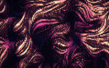</a> <b><a href="shaders/current.md">Flow Streaks</a></b> <code>current</code></td>
<td width="33%" valign="top"><a href="shaders/fret.md">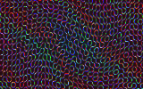</a> <b><a href="shaders/fret.md">Circuit Arcs</a></b> <code>fret</code></td>
<td width="33%" valign="top"><a href="shaders/skein.md">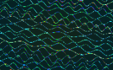</a> <b><a href="shaders/skein.md">Woven Lines</a></b> <code>skein</code></td>
</tr>
<tr>
<td width="33%" valign="top"><a href="shaders/harmonia.md">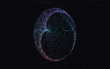</a> <b><a href="shaders/harmonia.md">Chord Circle</a></b> <code>harmonia</code></td>
<td width="33%" valign="top"><a href="shaders/halo.md">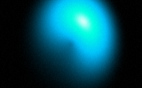</a> <b><a href="shaders/halo.md">Radial Bloom</a></b> <code>halo</code></td>
<td width="33%" valign="top"><a href="shaders/thermal.md">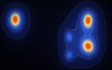</a> <b><a href="shaders/thermal.md">Heat Map</a></b> <code>thermal</code></td>
</tr>
<tr>
<td width="33%" valign="top"><a href="shaders/mesh.md">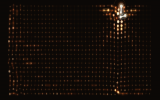</a> <b><a href="shaders/mesh.md">Spring Net</a></b> <code>mesh</code></td>
<td width="33%" valign="top"><a href="shaders/decrypt.md">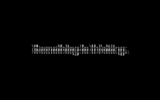</a> <b><a href="shaders/decrypt.md">Decode Lens</a></b> <code>decrypt</code></td>
<td width="33%" valign="top"><a href="shaders/datawall.md">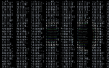</a> <b><a href="shaders/datawall.md">Cipher Wall</a></b> <code>datawall</code></td>
</tr>
<tr>
<td width="33%" valign="top"><a href="shaders/sand.md">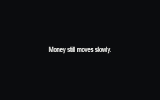</a> <b><a href="shaders/sand.md">Sand Text</a></b> <code>sand</code></td>
<td width="33%" valign="top"> <b><a href="shaders/assemble.md">Particle Portrait</a></b> <code>assemble</code></td>
<td width="33%" valign="top"><a href="shaders/aurora.md">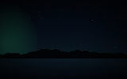</a> <b><a href="shaders/aurora.md">Aurora</a></b> <code>aurora</code></td>
</tr>
<tr>
<td width="33%" valign="top"><a href="shaders/horizon.md">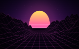</a> <b><a href="shaders/horizon.md">Synth Valley</a></b> <code>horizon</code></td>
<td width="33%" valign="top"><a href="shaders/blink.md">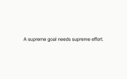</a> <b><a href="shaders/blink.md">Square Text</a></b> <code>blink</code></td>
<td width="33%" valign="top"> <b><a href="shaders/blinkfield.md">Square Field</a></b> <code>blinkfield</code></td>
</tr>
<tr>
<td width="33%" valign="top"> <b><a href="shaders/sparkle.md">Sparkle</a></b> <code>sparkle</code></td>
<td width="33%" valign="top"><a href="shaders/filings.md">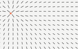</a> <b><a href="shaders/filings.md">Iron Filings</a></b> <code>filings</code></td>
<td width="33%" valign="top"><a href="shaders/gather.md">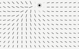</a> <b><a href="shaders/gather.md">Magnet Snap</a></b> <code>gather</code></td>
</tr>
<tr>
<td width="33%" valign="top"><a href="shaders/lattice.md">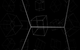</a> <b><a href="shaders/lattice.md">Cube Tunnel</a></b> <code>lattice</code></td>
<td width="33%" valign="top"><a href="shaders/orbits.md">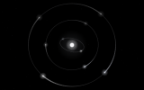</a> <b><a href="shaders/orbits.md">Orbit Rings</a></b> <code>orbits</code></td>
<td width="33%" valign="top"><a href="shaders/hearth.md">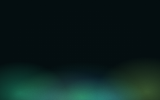</a> <b><a href="shaders/hearth.md">Glow Bed</a></b> <code>hearth</code></td>
</tr>
<tr>
<td width="33%" valign="top"><a href="shaders/lightsurge.md">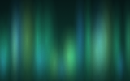</a> <b><a href="shaders/lightsurge.md">Light Surge</a></b> <code>lightsurge</code></td>
<td width="33%" valign="top"><a href="shaders/swirl.md">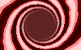</a> <b><a href="shaders/swirl.md">Silk Swirl</a></b> <code>swirl</code></td>
<td width="33%" valign="top"><a href="shaders/waves.md">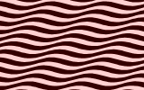</a> <b><a href="shaders/waves.md">Wave Bands</a></b> <code>waves</code></td>
</tr>
<tr>
<td width="33%" valign="top"><a href="shaders/stage.md">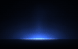</a> <b><a href="shaders/stage.md">Stage Light</a></b> <code>stage</code></td>
<td width="33%" valign="top"> <b><a href="shaders/globe.md">Dot Globe</a></b> <code>globe</code></td>
<td width="33%" valign="top"><a href="shaders/sweep.md">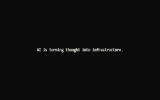</a> <b><a href="shaders/sweep.md">Glyph Sweep</a></b> <code>sweep</code></td>
</tr>
<tr>
<td width="33%" valign="top"> <b><a href="shaders/matrix.md">Matrix</a></b> <code>matrix</code></td>
<td width="33%" valign="top"> <b><a href="shaders/asciify.md">ASCII Text</a></b> <code>asciify</code></td>
<td width="33%" valign="top"><a href="shaders/graph.md">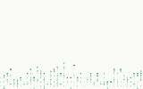</a> <b><a href="shaders/graph.md">Glyph Graph</a></b> <code>graph</code></td>
</tr>
<tr>
<td width="33%" valign="top"> <b><a href="shaders/glassicons.md">Glass Icons</a></b> <code>glassicons</code></td>
</tr>
</table>

| Shader | ID | Renderer | Description |
|---|---|---|---|
| [Flow Streaks](shaders/current.md) | `current` | GLSL · WebGL | Line-integral flow streaks that speed up, heat up and bend around the cursor. Renders at half resolution because it is heavy per pixel. |
| [Circuit Arcs](shaders/fret.md) | `fret` | GLSL · WebGL | Truchet arcs that join into endless circuits, with light pulses running along every path. |
| [Woven Lines](shaders/skein.md) | `skein` | GLSL · WebGL | Woven filaments that ripple at their own pace, drift sideways and draw in from the left. |
| [Chord Circle](shaders/harmonia.md) | `harmonia` | GLSL · WebGL | Times-table chords on a circle. As the multiplier drifts, cardioids, nephroids and roses appear. |
| [Radial Bloom](shaders/halo.md) | `halo` | GLSL · WebGL | A soft radial bloom with a slowly orbiting focal point. Made for hero backgrounds. |
| [Heat Map](shaders/thermal.md) | `thermal` | GLSL · WebGL | Drifting heat sources merge into a banded thermal map. |
| [Spring Net](shaders/mesh.md) | `mesh` | Canvas 2D | A spring lattice that glows by tension. Every kick travels across it like a struck net. |
| [Decode Lens](shaders/decrypt.md) | `decrypt` | GLSL · WebGL 2 | Text is rebuilt from best-fit glyphs and kept scrambled. A lens with a glowing, aberrated rim decodes it as it passes. |
| [Cipher Wall](shaders/datawall.md) | `datawall` | GLSL · WebGL 2 | A wall of backlog items held in cipher. Two lenses hunt across it and decode what they cross. |
| [Sand Text](shaders/sand.md) | `sand` | GLSL · WebGL 2 | Lines gather from fine drifting grains into crisp text, hold, then blow back to dust. |
| [Particle Portrait](shaders/assemble.md) | `assemble` | GLSL · WebGL | Thousands of particles orbit in a tilted ring, then swirl in to rebuild an image, catch a sweep of light and unravel again. |
| [Aurora](shaders/aurora.md) | `aurora` | Canvas 2D | Aurora curtains sweep in from the left over a ridge and a rippling lake, flare, then fade to start again. |
| [Synth Valley](shaders/horizon.md) | `horizon` | Canvas 2D | A striped sun rises behind a wireframe valley that flies toward the camera. |
| [Square Text](shaders/blink.md) | `blink` | Canvas 2D | Each line dissolves in square by square, holds, then blinks out. |
| [Square Field](shaders/blinkfield.md) | `blinkfield` | Canvas 2D | A floor of blinking squares rises and falls on a slow tide with a bright crest. |
| [Sparkle](shaders/sparkle.md) | `sparkle` | Canvas 2D | A sparkle spins in and punches through to colour, then the field closes back into a star and bursts into a twinkle of glints and sparks. |
| [Iron Filings](shaders/filings.md) | `filings` | Canvas 2D | A grid of iron filings turns to face a magnet as it sweeps, arcs and orbits. Far filings answer a beat late; a second pole repels. |
| [Magnet Snap](shaders/gather.md) | `gather` | Canvas 2D | Filings at rest catch a passing magnet, then collapse inward and lock into a 5×5 mark around it before letting go. |
| [Cube Tunnel](shaders/lattice.md) | `lattice` | Canvas 2D | An endless lattice of slowly turning wireframe cubes flows toward the camera and fades into the dark. |
| [Orbit Rings](shaders/orbits.md) | `orbits` | Canvas 2D | Tilted rings with tick marks sway round a haloed core over a faint starfield. Comets with fading tails pass behind and in front of the core. |
| [Glow Bed](shaders/hearth.md) | `hearth` | Canvas 2D | A bed of soft light breathes and sways along the bottom edge. |
| [Light Surge](shaders/lightsurge.md) | `lightsurge` | Canvas 2D | Columns of light rise from the floor over a colour wash, sway, then lift away on a cycle. Time a cut to the peak. |
| [Silk Swirl](shaders/swirl.md) | `swirl` | GLSL · WebGL | Silk bands spiral in toward the centre and keep turning. A native rewrite; no third-party shader code. |
| [Wave Bands](shaders/waves.md) | `waves` | Canvas 2D | Rows of soft waves drift across a second colour and breathe. |
| [Stage Light](shaders/stage.md) | `stage` | Canvas 2D | Light pours up from a glowing base, with soft shafts, a mirrored floor and drifting motes. |
| [Dot Globe](shaders/globe.md) | `globe` | Canvas 2D | A globe of dots turns slowly. Land on the near side lights up and pings. |
| [Glyph Sweep](shaders/sweep.md) | `sweep` | GLSL · WebGL 2 | A band of glyphs sweeps across the frame, tears the scanlines and swaps one line of text for the next. |
| [Matrix](shaders/matrix.md) | `matrix` | GLSL · WebGL 2 | Columns of green glyph rain fall over a line of text. Each falling head lights the words it passes. |
| [ASCII Text](shaders/asciify.md) | `asciify` | Canvas 2D | Crisp text wipes into ASCII glyphs, a scan band lights and densifies the characters it crosses, then the text wipes back. |
| [Glyph Graph](shaders/graph.md) | `graph` | GLSL · WebGL 2 | Columns of glyphs rise from the floor like a chart, keep moving, then climb to fill the frame and loop. |
| [Glass Icons](shaders/glassicons.md) | `glassicons` | three.js · WebGL | Clear prismatic glass icons with rainbow edges spin in, settle, and match-cut to the next. |

## Motion effects

All helpers live on `Shaderfield.motion`. One-shot helpers return a `Promise`; continuous helpers return a stop function.

### Text

| Effect | Helper | Description |
|---|---|---|
| [Type in](motion/type-in.md) | `typeIn` | Letter entrances. `mode`: `soft`, `decode`, `flip`, `scatter`, `glitch`. `accent`: two colours used for the chromatic split. |
| [Letter Rise](motion/rise.md) | `rise` | Each letter rises through its own mask on an expo ease. |
| [Line Rise](motion/line-rise.md) | `lineRise` | Each line rises from below its mask, then leaves upward. |
| [Block Reveal](motion/cut.md) | `cut` | A solid block wipes open, then its words roll up. |
| [Type Log](motion/type-lines.md) | `typeLines` | Log lines type out one by one and check off when done. |
| [Count Up](motion/count-up.md) | `countUp` | Numbers count up on an expo ease with steady-width digits. |
| [Reveal words](motion/reveal-words.md) | `revealWords` | Scroll-linked word reveal. Wrap words in `*asterisks*` to accent them. |
| [Type Swap](motion/type-swap.md) | `typeSwap` | The last word deletes, then the next one types in. |
| [Roll Words](motion/roll-words.md) | `rollWords` | Each word pushes the last out with a per-letter roll. |
| [Scramble Solve](motion/solve.md) | `solve` | Words roll in as scrambled glyphs, then resolve letter by letter. |
| [Letter Pop](motion/pop.md) | `pop` | Letters rise, overshoot and sharpen out of a blur. |
| [Lyric Flow](motion/lyric-flow.md) | `lyricFlow` | The current line lights up and the list glides to keep it centred. |
| [Neon Type](motion/neon-type.md) | `neonType` | Letters type on and flicker like neon before they hold. |
| [Focus Pull](motion/focus-pull.md) | `focusPull` | Text racks into focus out of a blur, by line or by letter. |
| [Track In](motion/track-in.md) | `trackIn` | A tagline tightens its letter spacing as it sharpens. |
| [Glyph Write](motion/glyph-write.md) | `glyphWrite` | Letters resolve left to right behind a short run of scrambled glyphs. |
| [Slam In](motion/slam-in.md) | `slamIn` | Oversized words fly in out of a blur, or drop from a giant zoom, then keep drifting. |

### Interface

| Effect | Helper | Description |
|---|---|---|
| [Tick Pop](motion/tick.md) | `tick` | A check pops out of an empty ring with a little overshoot. |
| [Progress Bars](motion/bars.md) | `bars` | Bars fill one after another on an expo ease. |
| [Focus Card](motion/focus-card.md) | `focusCard` | On hover, corner brackets snap in over a dot grid and spotlight. |
| [Press Ripple](motion/pressable.md) | `pressable` | A press squeezes the button and sends out layered ripples. |
| [Signal Bars](motion/signal-bars.md) | `signalBars` | Thin status bars grow in a staggered sweep to show uptime. |
| [Tab Morph](motion/tab-morph.md) | `tabMorph` | The active icon tab springs open to show its label. |
| [Masked Scroll](motion/masked-scroll.md) | `maskedScroll` | A list glides under a fade mask so rows dissolve at the edge. |
| [Spring follow](motion/spring-follow.md) | `springFollow` | A label follows the cursor on a spring. Use `stop.set({ stiffness, damping })`. |
| [Pen Trail](motion/pen-trail.md) | `penTrail` | A pen leaves a fading, tapering stroke and reveals a wordmark. |
| [Bracket Hop](motion/bracket-hop.md) | `bracketHop` | Corner brackets spin between targets and snap open around each. |
| [Bracket Cursor](motion/bracket-cursor.md) | `bracketCursor` | The pointer becomes a reticle that snaps around links. |
| [Color Index](motion/color-index.md) | `colorIndex` | A project list steps row by row as the background changes colour. |
| [Disc Stack](motion/disc-stack.md) | `discStack` | Tilted discs cycle: the top one lifts away and returns at the back. |
| [Shine](motion/shine.md) | `shine` | A crisp glint sweeps across a button once. |
| [Typing Dots](motion/typing-dots.md) | `typingDots` | Three dots bounce in a wave while a reply is coming. |
| [Click Cursor](motion/click-cursor.md) | `clickCursor` | A pointer arcs in, clicks, and fires sparks and a ripple. |
| [Scan Beam](motion/scan-beam.md) | `scanBeam` | A glowing scanline sweeps a card and lights up each field. |
| [Wire Draw](motion/wire.md) | `wire` | Curved connectors draw from one element to several others. |
| [Pick Focus](motion/pick-focus.md) | `pickFocus` | All options pulse, then the chosen one lights up and the rest dim. |
| [Lock Click](motion/lock-click.md) | `lockClick` | A padlock drops in, snaps shut, then turns into a check. |
| [Odometer](motion/odometer.md) | `odometer` | A count rolls to its next value. The old number blurs up and out as the new one rises in. |
| [Toast Stack](motion/toast-stack.md) | `toastStack` | Notifications land stacked behind each other, then fan out into a list. |
| [Dot Morph](motion/dot-morph.md) | `dotMorph` | A dot of colour stretches into the pill behind a label, and the label flips to ink. |

### Transitions

| Effect | Helper | Description |
|---|---|---|
| [Curtain](motion/curtain.md) | `curtain` | Pixel cells cover, `onSwap` runs, then they clear. |
| [Iris Close](motion/iris.md) | `iris` | A card closes to a hairline, pinches to the centre, then reopens. |
| [Line Draw](motion/draw-frame.md) | `drawFrame` | A hairline frame and an underline draw themselves in. |
| [Line Draw](motion/draw-line.md) | `drawLine` | A hairline frame and an underline draw themselves in. |
| [Block Reveal](motion/stripes.md) | `stripes` | A solid block wipes open, then its words roll up. |
| [Camera Push](motion/camera-push.md) | `cameraPush` | The layout scales and pans until one element fills the frame. |
| [Light Flash](motion/flash.md) | `flash` | The frame snaps to light on a hit, then falls off fast. |
| [Radial Reveal](motion/radial-reveal.md) | `radialReveal` | Elements appear in a ring that grows from the centre. |
| [Footer Reveal](motion/underlay-reveal.md) | `underlayReveal` | The page lifts away to reveal the footer underneath. |
| [Shock Ring](motion/shock.md) | `shock` | A thin glowing ring bursts out from a point. |
| [Push Through](motion/push-through.md) | `pushThrough` | The scene zooms toward one point while it blurs away. |
| [Blinds](motion/blinds.md) | `blinds` | Horizontal bands close from their centre lines in a ragged order, the scene swaps, and they open again. |
| [Column Rise](motion/column-wipe.md) | `columnWipe` | Stepped columns of colour rise to cover the frame, the scene swaps, then they retreat upward. |
| [Block Wipe](motion/block-wipe.md) | `blockWipe` | A grid of blocks fills from one corner, the scene swaps, and the blocks clear in the same direction. |

### Light

| Effect | Helper | Description |
|---|---|---|
| [Glow Sheen](motion/glow-text.md) | `glowText` | A bright band drifts through gradient text under a soft glow. |
