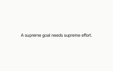

<sub><a href="../../README.md">Shaderfield</a> / <a href="../README.md">Components</a> / Shaders</sub>

# Square Text



Each line dissolves in square by square, holds, then blinks out.

| | |
|---|---|
| **ID** | `blink` |
| **Renderer** | Canvas 2D |
| **Interaction** | Move to stir the squares |
| **Default palette** | `mint` |
| **Works with** | `mint`, `ledger`, `phosphor`, `cobalt`, `ember` |
| **Default text** | “A supreme goal needs supreme effort.”<br>“Good enough never wins.”<br>“Supreme effort. Supreme results.” |
| **Live demo** | [Open in the library](../../components.html#blink) |

## Usage

### HTML

```html
<script src="shaderfield.js"></script>

<shader-field effect="blink" palette="mint" interactive
  style="position:absolute; inset:0"></shader-field>
```

### JavaScript

```js
const field = Shaderfield.mount(element, {
  effect: "blink",
  palette: "mint",
  params: { square: 12 }
});
```

Set your own text with the `text` attribute or `field.setText()`. Separate lines with `|`.

## Parameters

Every parameter is also an HTML attribute. Attributes are live: change one and the shader updates on the next frame.

| Parameter | Attribute | Range | Default |
|---|---|---|---|
| Square | `square` | 4 – 40 | 12 |
| Gap | `gap` | 0 – 16 | 4 |
| Hold | `hold` | 1.2 – 6s | 1.9 |
| Paper | `paper` | 0 – 1 | 1 |
| Text size | `size` | 0.02 – 0.12 | 0.06 |
| Speed | `speed` | 0 – 3 | 1 |

## Export

- **PNG:** `field.png()` returns a data URL of the current frame.
- **Video:** `field.record({ seconds, width, height, fps })` returns a `Promise<Blob>`.
- **Frame by frame:** mount with `autoplay: false` and call `field.render(seconds)`. The same time always draws the same frame.

See the [JavaScript API](../../README.md#javascript-api) for every method.
