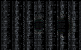

<sub><a href="../../README.md">Shaderfield</a> / <a href="../README.md">Components</a> / Shaders</sub>

# Cipher Wall



A wall of backlog items held in cipher. Two lenses hunt across it and decode what they cross.

| | |
|---|---|
| **ID** | `datawall` |
| **Renderer** | GLSL · WebGL 2 |
| **Interaction** | Move to steer the first lens |
| **Default palette** | `aqua` |
| **Works with** | `aqua`, `ion`, `phosphor`, `ember` |
| **Live demo** | [Open in the library](../../components.html#datawall) |

## Usage

### HTML

```html
<script src="shaderfield.js"></script>

<shader-field effect="datawall" palette="aqua" interactive
  style="position:absolute; inset:0"></shader-field>
```

### JavaScript

```js
const field = Shaderfield.mount(element, {
  effect: "datawall",
  palette: "aqua",
  params: { radius: 0.22 }
});
```

## Parameters

Every parameter is also an HTML attribute. Attributes are live: change one and the shader updates on the next frame.

| Parameter | Attribute | Range | Default |
|---|---|---|---|
| Lens | `radius` | 0.05 – 0.6 | 0.22 |
| Softness | `softness` | 0.02 – 1 | 0.5 |
| Cell | `cell` | 8 – 32 | 15 |
| Scramble | `scramble` | 0 – 1 | 0.1 |
| Edge glow | `edge` | 0 – 4 | 2 |
| Chroma split | `split` | 0 – 30 | 10 |
| Pass-through | `pass` | 0 – 1 | 0.15 |
| Speed | `speed` | 0 – 3 | 1 |

## Export

- **PNG:** `field.png()` returns a data URL of the current frame.
- **Video:** `field.record({ seconds, width, height, fps })` returns a `Promise<Blob>`.
- **Frame by frame:** mount with `autoplay: false` and call `field.render(seconds)`. The same time always draws the same frame.

See the [JavaScript API](../../README.md#javascript-api) for every method.
