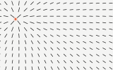

<sub><a href="../../README.md">Shaderfield</a> / <a href="../README.md">Components</a> / Shaders</sub>

# Iron Filings



A grid of iron filings turns to face a magnet as it sweeps, arcs and orbits. Far filings answer a beat late; a second pole repels.

| | |
|---|---|
| **ID** | `filings` |
| **Renderer** | Canvas 2D |
| **Interaction** | Move to become the magnet |
| **Default palette** | `mono` |
| **Works with** | `mono` |
| **Live demo** | [Open in the library](../../components.html#filings) |

## Usage

### HTML

```html
<script src="shaderfield.js"></script>

<shader-field effect="filings" palette="mono" interactive
  style="position:absolute; inset:0"></shader-field>
```

### JavaScript

```js
const field = Shaderfield.mount(element, {
  effect: "filings",
  palette: "mono",
  params: { cell: 60 }
});
```

## Parameters

Every parameter is also an HTML attribute. Attributes are live: change one and the shader updates on the next frame.

| Parameter | Attribute | Range | Default |
|---|---|---|---|
| Cell | `cell` | 24 – 120 | 60 |
| Zoom | `zoom` | 1 – 2.5 | 1.6 |
| Lag | `lag` | 0 – 3 | 1 |
| Cycle | `cycle` | 6 – 30s | 12 |
| Show magnet | `magnet` | 0 – 1 | 1 |
| Paper | `paper` | 0 – 1 | 1 |
| Speed | `speed` | 0 – 3 | 1 |

## Export

- **PNG:** `field.png()` returns a data URL of the current frame.
- **Video:** `field.record({ seconds, width, height, fps })` returns a `Promise<Blob>`.
- **Frame by frame:** mount with `autoplay: false` and call `field.render(seconds)`. The same time always draws the same frame.

See the [JavaScript API](../../README.md#javascript-api) for every method.
