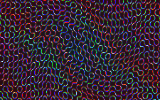

<sub><a href="../../README.md">Shaderfield</a> / <a href="../README.md">Components</a> / Shaders</sub>

# Circuit Arcs



Truchet arcs that join into endless circuits, with light pulses running along every path.

| | |
|---|---|
| **ID** | `fret` |
| **Renderer** | GLSL · WebGL |
| **Interaction** | The cursor swirls the grid, and a click sends a shockwave |
| **Default palette** | `ion` |
| **Live demo** | [Open in the library](../../components.html#fret) |

## Usage

### HTML

```html
<script src="shaderfield.js"></script>

<shader-field effect="fret" palette="ion" interactive
  style="position:absolute; inset:0"></shader-field>
```

### JavaScript

```js
const field = Shaderfield.mount(element, {
  effect: "fret",
  palette: "ion",
  params: { cell: 24 }
});
```

## Parameters

Every parameter is also an HTML attribute. Attributes are live: change one and the shader updates on the next frame.

| Parameter | Attribute | Range | Default |
|---|---|---|---|
| Cell | `cell` | 10 – 60 | 24 |
| Line | `line` | 0.5 – 4 | 1.3 |
| Glow | `glow` | 0 – 1 | 0.6 |
| Pulse | `pulse` | 0 – 1.5 | 1 |
| Weld | `weld` | 0 – 1 | 0.2 |
| Swirl | `warp` | 0 – 1 | 0.15 |
| Chroma split | `split` | 0 – 4 | 0.6 |
| Speed | `speed` | 0 – 3 | 1 |

## Export

- **PNG:** `field.png()` returns a data URL of the current frame.
- **Video:** `field.record({ seconds, width, height, fps })` returns a `Promise<Blob>`.
- **Frame by frame:** mount with `autoplay: false` and call `field.render(seconds)`. The same time always draws the same frame.

See the [JavaScript API](../../README.md#javascript-api) for every method.
