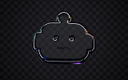

<sub><a href="../../README.md">Shaderfield</a> / <a href="../README.md">Components</a> / Shaders</sub>

# Glass Icons



Clear prismatic glass icons with rainbow edges spin in, settle, and match-cut to the next.

| | |
|---|---|
| **ID** | `glassicons` |
| **Renderer** | three.js · WebGL |
| **Interaction** | Move to tilt the glass |
| **Default palette** | `mono` |
| **Works with** | `mono`, `cobalt`, `ion`, `aurora`, `ember` |
| **Requires** | `shaderfield-glass.js` (loads three.js on first use) |
| **Live demo** | [Open in the library](../../components.html#glassicons) |

## Usage

### HTML

```html
<script src="shaderfield.js"></script>
<script src="shaderfield-glass.js"></script>

<shader-field effect="glassicons" palette="mono" interactive
  style="position:absolute; inset:0"></shader-field>
```

### JavaScript

```js
const field = Shaderfield.mount(element, {
  effect: "glassicons",
  palette: "mono",
  params: { hold: 3 }
});
```

## Parameters

Every parameter is also an HTML attribute. Attributes are live: change one and the shader updates on the next frame.

| Parameter | Attribute | Range | Default |
|---|---|---|---|
| Hold | `hold` | 1.5 – 6s | 3 |
| Dispersion | `dispersion` | 0 – 6 | 2.2 |
| Depth | `depth` | 0.05 – 0.4 | 0.22 |
| Speed | `speed` | 0 – 3 | 1 |

## Export

- **PNG:** `field.png()` returns a data URL of the current frame.
- **Video:** `field.record({ seconds, width, height, fps })` returns a `Promise<Blob>`.
- **Frame by frame:** mount with `autoplay: false` and call `field.render(seconds)`. The same time always draws the same frame.

See the [JavaScript API](../../README.md#javascript-api) for every method.
