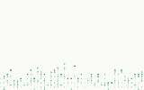

<sub><a href="../../README.md">Shaderfield</a> / <a href="../README.md">Components</a> / Shaders</sub>

# Glyph Graph



Columns of glyphs rise from the floor like a chart, keep moving, then climb to fill the frame and loop.

| | |
|---|---|
| **ID** | `graph` |
| **Renderer** | GLSL · WebGL 2 |
| **Interaction** | None |
| **Default palette** | `sky` |
| **Works with** | `sky`, `ledger`, `mint`, `phosphor`, `cobalt` |
| **Live demo** | [Open in the library](../../components.html#graph) |

## Usage

### HTML

```html
<script src="shaderfield.js"></script>

<shader-field effect="graph" palette="sky"
  style="position:absolute; inset:0"></shader-field>
```

### JavaScript

```js
const field = Shaderfield.mount(element, {
  effect: "graph",
  palette: "sky",
  params: { height: 0.4 }
});
```

## Parameters

Every parameter is also an HTML attribute. Attributes are live: change one and the shader updates on the next frame.

| Parameter | Attribute | Range | Default |
|---|---|---|---|
| Height | `height` | 0.1 – 0.9 | 0.4 |
| Cycle | `cycle` | 4 – 30s | 8 |
| Glyph | `glyph` | 0.5 – 10 | 6 |
| Charset | `charset` | 0 – 2 | 0 |
| Paper | `paper` | 0 – 1 | 1 |
| Text size | `size` | 0.03 – 0.2 | 0.07 |
| Speed | `speed` | 0 – 3 | 1 |

## Export

- **PNG:** `field.png()` returns a data URL of the current frame.
- **Video:** `field.record({ seconds, width, height, fps })` returns a `Promise<Blob>`.
- **Frame by frame:** mount with `autoplay: false` and call `field.render(seconds)`. The same time always draws the same frame.

See the [JavaScript API](../../README.md#javascript-api) for every method.
