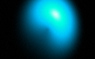

<sub><a href="../../README.md">Shaderfield</a> / <a href="../README.md">Components</a> / Shaders</sub>

# Radial Bloom



A soft radial bloom with a slowly orbiting focal point. Made for hero backgrounds.

| | |
|---|---|
| **ID** | `halo` |
| **Renderer** | GLSL · WebGL |
| **Interaction** | The cursor pulls the focal point |
| **Default palette** | `aqua` |
| **Live demo** | [Open in the library](../../components.html#halo) |

## Usage

### HTML

```html
<script src="shaderfield.js"></script>

<shader-field effect="halo" palette="aqua" interactive
  style="position:absolute; inset:0"></shader-field>
```

### JavaScript

```js
const field = Shaderfield.mount(element, {
  effect: "halo",
  palette: "aqua",
  params: { radius: 0.8 }
});
```

## Parameters

Every parameter is also an HTML attribute. Attributes are live: change one and the shader updates on the next frame.

| Parameter | Attribute | Range | Default |
|---|---|---|---|
| Radius | `radius` | 0.1 – 1.4 | 0.8 |
| Falloff | `falloff` | 0.05 – 0.6 | 0.24 |
| Focal | `focal` | 0 – 1 | 0.7 |
| Orbit, °/s | `spin` | 0 – 60 | 14 |
| Core | `core` | 0 – 1 | 0.8 |
| Grain | `grain` | 0 – 0.15 | 0.03 |
| Speed | `speed` | 0 – 3 | 1 |

## Export

- **PNG:** `field.png()` returns a data URL of the current frame.
- **Video:** `field.record({ seconds, width, height, fps })` returns a `Promise<Blob>`.
- **Frame by frame:** mount with `autoplay: false` and call `field.render(seconds)`. The same time always draws the same frame.

See the [JavaScript API](../../README.md#javascript-api) for every method.
