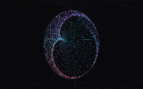

<sub><a href="../../README.md">Shaderfield</a> / <a href="../README.md">Components</a> / Shaders</sub>

# Chord Circle



Times-table chords on a circle. As the multiplier drifts, cardioids, nephroids and roses appear.

| | |
|---|---|
| **ID** | `harmonia` |
| **Renderer** | GLSL · WebGL |
| **Interaction** | Horizontal cursor position shifts the multiplier |
| **Default palette** | `solar` |
| **Live demo** | [Open in the library](../../components.html#harmonia) |

## Usage

### HTML

```html
<script src="shaderfield.js"></script>

<shader-field effect="harmonia" palette="solar" interactive
  style="position:absolute; inset:0"></shader-field>
```

### JavaScript

```js
const field = Shaderfield.mount(element, {
  effect: "harmonia",
  palette: "solar",
  params: { points: 120 }
});
```

## Parameters

Every parameter is also an HTML attribute. Attributes are live: change one and the shader updates on the next frame.

| Parameter | Attribute | Range | Default |
|---|---|---|---|
| Points | `points` | 20 – 150 | 120 |
| Horizontal | `offset` | -0.4 – 0.4 | 0 |
| Multiplier | `mult` | 2 – 40 | 2 |
| Drift | `drift` | 0 – 0.5 | 0.06 |
| Radius | `radius` | 0.2 – 0.48 | 0.38 |
| Line | `line` | 0.3 – 2 | 0.7 |
| Glow | `glow` | 0 – 1.5 | 0.8 |
| Dots | `dots` | 0 – 1 | 0.5 |
| Field | `field` | 0 – 1 | 0.35 |
| Ring | `ring` | 0 – 1 | 0.5 |
| Speed | `speed` | 0 – 3 | 1 |

## Export

- **PNG:** `field.png()` returns a data URL of the current frame.
- **Video:** `field.record({ seconds, width, height, fps })` returns a `Promise<Blob>`.
- **Frame by frame:** mount with `autoplay: false` and call `field.render(seconds)`. The same time always draws the same frame.

See the [JavaScript API](../../README.md#javascript-api) for every method.
