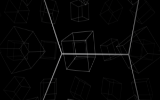

<sub><a href="../../README.md">Shaderfield</a> / <a href="../README.md">Components</a> / Shaders</sub>

# Cube Tunnel



An endless lattice of slowly turning wireframe cubes flows toward the camera and fades into the dark.

| | |
|---|---|
| **ID** | `lattice` |
| **Renderer** | Canvas 2D |
| **Interaction** | Move to steer the camera |
| **Default palette** | `mono` |
| **Works with** | `mono`, `aqua`, `ember`, `aurora` |
| **Live demo** | [Open in the library](../../components.html#lattice) |

## Usage

### HTML

```html
<script src="shaderfield.js"></script>

<shader-field effect="lattice" palette="mono" interactive
  style="position:absolute; inset:0"></shader-field>
```

### JavaScript

```js
const field = Shaderfield.mount(element, {
  effect: "lattice",
  palette: "mono",
  params: { rate: 0.8 }
});
```

## Parameters

Every parameter is also an HTML attribute. Attributes are live: change one and the shader updates on the next frame.

| Parameter | Attribute | Range | Default |
|---|---|---|---|
| Flight | `rate` | 0 – 4 | 0.8 |
| Spin | `spin` | 0 – 3 | 1 |
| Cube | `size` | 0.3 – 2 | 1 |
| Speed | `speed` | 0 – 3 | 1 |

## Export

- **PNG:** `field.png()` returns a data URL of the current frame.
- **Video:** `field.record({ seconds, width, height, fps })` returns a `Promise<Blob>`.
- **Frame by frame:** mount with `autoplay: false` and call `field.render(seconds)`. The same time always draws the same frame.

See the [JavaScript API](../../README.md#javascript-api) for every method.
