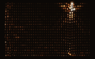

<sub><a href="../../README.md">Shaderfield</a> / <a href="../README.md">Components</a> / Shaders</sub>

# Spring Net



A spring lattice that glows by tension. Every kick travels across it like a struck net.

| | |
|---|---|
| **ID** | `mesh` |
| **Renderer** | Canvas 2D |
| **Interaction** | Moving the cursor pushes the lattice, and a click strikes it |
| **Works with** | `ember`, `ion`, `aurora`, `mono` |
| **Live demo** | [Open in the library](../../components.html#mesh) |

## Usage

### HTML

```html
<script src="shaderfield.js"></script>

<shader-field effect="mesh" interactive
  style="position:absolute; inset:0"></shader-field>
```

### JavaScript

```js
const field = Shaderfield.mount(element, {
  effect: "mesh",
  params: { energy: 1 }
});
```

## Parameters

Every parameter is also an HTML attribute. Attributes are live: change one and the shader updates on the next frame.

| Parameter | Attribute | Range | Default |
|---|---|---|---|
| Energy | `energy` | 0 – 2 | 1 |
| Stiffness | `stiffness` | 0.04 – 0.3 | 0.12 |
| Damping | `damping` | 0.95 – 0.995 | 0.978 |
| Per second | `kicks` | 0 – 3 | 0.8 |
| Speed | `speed` | 0 – 3 | 1 |

---

## Export

- **PNG:** `field.png()` returns a data URL of the current frame.
- **Video:** `field.record({ seconds, width, height, fps })` returns a `Promise<Blob>`.
- **Frame by frame:** mount with `autoplay: false` and call `field.render(seconds)`. The same time always draws the same frame.

See the [JavaScript API](../../README.md#javascript-api) for every method.
