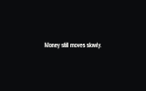

<sub><a href="../../README.md">Shaderfield</a> / <a href="../README.md">Components</a> / Shaders</sub>

# Sand Text



Lines gather from fine drifting grains into crisp text, hold, then blow back to dust.

| | |
|---|---|
| **ID** | `sand` |
| **Renderer** | GLSL · WebGL 2 |
| **Interaction** | Move up and down to gather and scatter |
| **Default palette** | `mono` |
| **Works with** | `mono` |
| **Default text** | “Money still moves slowly.”<br>“Forms. Fees. Waiting.”<br>“Transactions, made effortless.” |
| **Live demo** | [Open in the library](../../components.html#sand) |

## Usage

### HTML

```html
<script src="shaderfield.js"></script>

<shader-field effect="sand" palette="mono" interactive
  style="position:absolute; inset:0"></shader-field>
```

### JavaScript

```js
const field = Shaderfield.mount(element, {
  effect: "sand",
  palette: "mono",
  params: { grain: 2.2 }
});
```

Set your own text with the `text` attribute or `field.setText()`. Separate lines with `|`.

## Parameters

Every parameter is also an HTML attribute. Attributes are live: change one and the shader updates on the next frame.

| Parameter | Attribute | Range | Default |
|---|---|---|---|
| Grain | `grain` | 1.5 – 8 | 2.2 |
| Spread | `spread` | 20 – 600 | 200 |
| Band | `band` | 60 – 600 | 180 |
| Swirl | `swirl` | 0 – 200 | 36 |
| Drift | `drift` | 0 – 2 | 0.45 |
| Gravity | `gravity` | -1 – 1 | 0.35 |
| Cycle | `cycle` | 2 – 12s | 3.4 |
| Text size | `size` | 0.03 – 0.2 | 0.07 |
| Speed | `speed` | 0 – 3 | 1 |

## Export

- **PNG:** `field.png()` returns a data URL of the current frame.
- **Video:** `field.record({ seconds, width, height, fps })` returns a `Promise<Blob>`.
- **Frame by frame:** mount with `autoplay: false` and call `field.render(seconds)`. The same time always draws the same frame.

See the [JavaScript API](../../README.md#javascript-api) for every method.
