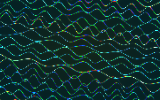

<sub><a href="../../README.md">Shaderfield</a> / <a href="../README.md">Components</a> / Shaders</sub>

# Woven Lines



Woven filaments that ripple at their own pace, drift sideways and draw in from the left.

| | |
|---|---|
| **ID** | `skein` |
| **Renderer** | GLSL · WebGL |
| **Interaction** | A click sends a shockwave |
| **Default palette** | `aurora` |
| **Live demo** | [Open in the library](../../components.html#skein) |

## Usage

### HTML

```html
<script src="shaderfield.js"></script>

<shader-field effect="skein" palette="aurora" interactive
  style="position:absolute; inset:0"></shader-field>
```

### JavaScript

```js
const field = Shaderfield.mount(element, {
  effect: "skein",
  palette: "aurora",
  params: { cell: 22 }
});
```

## Parameters

Every parameter is also an HTML attribute. Attributes are live: change one and the shader updates on the next frame.

| Parameter | Attribute | Range | Default |
|---|---|---|---|
| Spacing | `cell` | 10 – 60 | 22 |
| Line | `line` | 0.5 – 4 | 1.3 |
| Wave | `wave` | 0 – 1.5 | 0.55 |
| Variety | `vary` | 0 – 1 | 0.7 |
| Tilt | `tilt` | −45 – 45° | −8 |
| Scatter | `scatter` | 0 – 1 | 0.5 |
| Depth | `depth` | 0 – 1 | 0.6 |
| Glow | `glow` | 0 – 1 | 0.6 |
| Draw-in | `draw` | 0 – 1 | 1 |
| Chroma split | `split` | 0 – 4 | 0.4 |
| Speed | `speed` | 0 – 3 | 1 |

> **Tip:** animate `draw` from 0 to 1 for an entrance.

## Export

- **PNG:** `field.png()` returns a data URL of the current frame.
- **Video:** `field.record({ seconds, width, height, fps })` returns a `Promise<Blob>`.
- **Frame by frame:** mount with `autoplay: false` and call `field.render(seconds)`. The same time always draws the same frame.

See the [JavaScript API](../../README.md#javascript-api) for every method.
