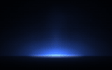

<sub><a href="../../README.md">Shaderfield</a> / <a href="../README.md">Components</a> / Shaders</sub>

# Stage Light



Light pours up from a glowing base, with soft shafts, a mirrored floor and drifting motes.

| | |
|---|---|
| **ID** | `stage` |
| **Renderer** | Canvas 2D |
| **Interaction** | Move to steer the light |
| **Default palette** | `cobalt` |
| **Works with** | `cobalt`, `aqua`, `synth`, `aurora`, `ember` |
| **Live demo** | [Open in the library](../../components.html#stage) |

## Usage

### HTML

```html
<script src="shaderfield.js"></script>

<shader-field effect="stage" palette="cobalt" interactive
  style="position:absolute; inset:0"></shader-field>
```

### JavaScript

```js
const field = Shaderfield.mount(element, {
  effect: "stage",
  palette: "cobalt",
  params: { intensity: 1 }
});
```

## Parameters

Every parameter is also an HTML attribute. Attributes are live: change one and the shader updates on the next frame.

| Parameter | Attribute | Range | Default |
|---|---|---|---|
| Intensity | `intensity` | 0.3 – 2 | 1 |
| Reach | `reach` | 0.2 – 1 | 0.62 |
| Base width | `width` | 0.1 – 0.9 | 0.42 |
| Base height | `base` | 0.5 – 0.95 | 0.8 |
| Shafts | `shafts` | 0 – 1 | 0.6 |
| Motes | `motes` | 0 – 1 | 0.5 |
| Breathe | `breathe` | 0 – 1 | 0.5 |
| Speed | `speed` | 0 – 3 | 1 |

## Export

- **PNG:** `field.png()` returns a data URL of the current frame.
- **Video:** `field.record({ seconds, width, height, fps })` returns a `Promise<Blob>`.
- **Frame by frame:** mount with `autoplay: false` and call `field.render(seconds)`. The same time always draws the same frame.

See the [JavaScript API](../../README.md#javascript-api) for every method.
