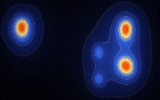

<sub><a href="../../README.md">Shaderfield</a> / <a href="../README.md">Components</a> / Shaders</sub>

# Heat Map



Drifting heat sources merge into a banded thermal map.

| | |
|---|---|
| **ID** | `thermal` |
| **Renderer** | GLSL · WebGL |
| **Interaction** | The cursor adds heat |
| **Default palette** | `heat` |
| **Live demo** | [Open in the library](../../components.html#thermal) |

## Usage

### HTML

```html
<script src="shaderfield.js"></script>

<shader-field effect="thermal" palette="heat" interactive
  style="position:absolute; inset:0"></shader-field>
```

### JavaScript

```js
const field = Shaderfield.mount(element, {
  effect: "thermal",
  palette: "heat",
  params: { blobs: 5 }
});
```

## Parameters

Every parameter is also an HTML attribute. Attributes are live: change one and the shader updates on the next frame.

| Parameter | Attribute | Range | Default |
|---|---|---|---|
| Sources | `blobs` | 1 – 6 | 5 |
| Size | `size` | 0.4 – 2.5 | 1.45 |
| Bands | `bands` | 2 – 24 | 9 |
| Contour | `contour` | 0 – 1 | 0.5 |
| Glow | `glow` | 0 – 1 | 0.6 |
| Grain | `grain` | 0 – 0.15 | 0.03 |
| Speed | `speed` | 0 – 3 | 1 |

## Export

- **PNG:** `field.png()` returns a data URL of the current frame.
- **Video:** `field.record({ seconds, width, height, fps })` returns a `Promise<Blob>`.
- **Frame by frame:** mount with `autoplay: false` and call `field.render(seconds)`. The same time always draws the same frame.

See the [JavaScript API](../../README.md#javascript-api) for every method.
