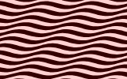

<sub><a href="../../README.md">Shaderfield</a> / <a href="../README.md">Components</a> / Shaders</sub>

# Wave Bands



Rows of soft waves drift across a second colour and breathe.

| | |
|---|---|
| **ID** | `waves` |
| **Renderer** | Canvas 2D |
| **Interaction** | Move to swell the waves |
| **Default palette** | `silk` |
| **Works with** | `silk`, `ember`, `mint`, `cobalt`, `mono` |
| **Live demo** | [Open in the library](../../components.html#waves) |

## Usage

### HTML

```html
<script src="shaderfield.js"></script>

<shader-field effect="waves" palette="silk" interactive
  style="position:absolute; inset:0"></shader-field>
```

### JavaScript

```js
const field = Shaderfield.mount(element, {
  effect: "waves",
  palette: "silk",
  params: { gap: 96 }
});
```

## Parameters

Every parameter is also an HTML attribute. Attributes are live: change one and the shader updates on the next frame.

| Parameter | Attribute | Range | Default |
|---|---|---|---|
| Spacing | `gap` | 16 – 200 | 96 |
| Thickness | `thick` | 0.1 – 0.9 | 0.46 |
| Wave | `amp` | 0 – 80 | 26 |
| Length | `length` | 80 – 1400 | 640 |
| Drift | `drift` | 0 – 6 | 2.6 |
| Breathe | `breathe` | 0 – 1 | 0.35 |
| Tilt | `tilt` | −30 – 30° | 0 |
| Two colours | `duo` | 0 – 1 | 0 |
| Speed | `speed` | 0 – 3 | 1 |

## Export

- **PNG:** `field.png()` returns a data URL of the current frame.
- **Video:** `field.record({ seconds, width, height, fps })` returns a `Promise<Blob>`.
- **Frame by frame:** mount with `autoplay: false` and call `field.render(seconds)`. The same time always draws the same frame.

See the [JavaScript API](../../README.md#javascript-api) for every method.
